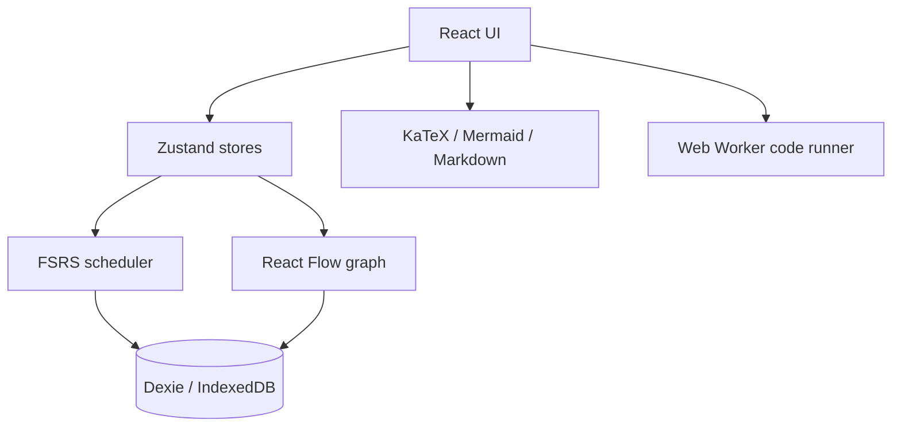

# DataFlow

DataFlow is a local-first knowledge graph and spaced-repetition workspace for organizing technical concepts. Nodes are connected on an interactive React Flow canvas and can carry review metadata, formulas, Mermaid diagrams, Markdown, and executable JavaScript examples.

## Screenshots

Screenshots can be added here as the UI evolves.

## Features

- Interactive prerequisite-aware knowledge graph.
- FSRS-inspired review scheduling with four ratings and explicit one-minute and ten-minute learning steps.
- Node CRUD with cycle-safe prerequisite validation.
- LaTeX, Mermaid, sanitized Markdown, and worker-isolated code examples.
- IndexedDB persistence for nodes, cards, review logs, and graph positions.
- JSON export/import with schema validation.
- Review statistics, retention, streaks, optional seven-day prerequisite gating, and Dagre auto-layout.
- Responsive dark interface with keyboard review shortcuts: `Space` to show an answer and `1`–`4` to rate it.

## Technical Stack

| Area | Technology |
| --- | --- |
| UI | React 19.1 and React DOM |
| Language | TypeScript 5.8 |
| Build | Vite 6 |
| Styling | Tailwind CSS 3, PostCSS, Autoprefixer |
| Graph | `@xyflow/react` |
| State | Zustand |
| Persistence | Dexie and `dexie-react-hooks` |
| Rendering | KaTeX, Mermaid, `react-markdown`, DOMPurify |
| Scheduling | A local FSRS-inspired TypeScript engine |
| Layout | `@dagrejs/dagre` |
| Quality | Vitest, fake-indexeddb, ESLint, Prettier |

## Architecture



## Scheduling Maths

The scheduler uses the desired retention `R = 0.9` and the FSRS retrievability curve:

`R(t, S) = (1 + (19 / 81) × t / S)^(-0.5)`

Intervals are calculated as the rounded number of days required to reach the desired retention, with a minimum of one day. Initial stability is selected from the first four scheduler weights. Difficulty is clamped to `[1, 10]` and updated with the rating-neutral initial difficulty and the rating offset around **Good**. New cards use learning steps of **1 minute** and **10 minutes** before entering review.

## Development

```bash
npm install
npm run dev
```

### Scripts

- `npm run dev` — start Vite development mode.
- `npm run build` — typecheck and create a production bundle.
- `npm run typecheck` — run the TypeScript project build without bundling.
- `npm test` — run the Vitest suite once.
- `npm run lint` — run ESLint.

## Limitations

- Data is stored locally in the browser; there is no sync service.
- Worker code execution intentionally does not expose DOM, `window`, IndexedDB, or canvas APIs and is terminated after three seconds.
- Browser storage can be cleared by the user or browser privacy settings.
- The graph bundle still contains large Mermaid-related chunks; Vite reports these as build warnings.

## License

MIT. See [LICENSE](LICENSE).
