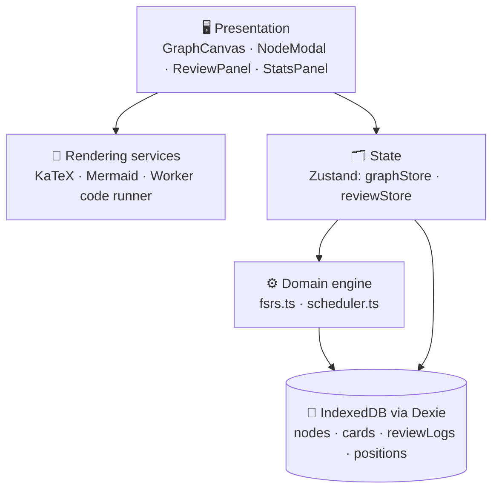

<div align="center">

# 🌌 DataFlow

### Spatial Knowledge Graphs × FSRS Spaced Repetition

**Map what you know. Review what you're about to forget.**

[](https://brundag22.github.io/DataFlow/)
[](https://github.com/brundag22/DataFlow/actions)
[](LICENSE)


<!-- 📸 Replace with a real screenshot or GIF of the graph canvas -->
<!--  -->

</div>

---

## 📌 Overview

Flashcard apps treat knowledge as a flat deck. **DataFlow treats it as a graph.**

Every concept is a **node** on an infinite canvas, linked to its **prerequisites**. Every node is also a **review card** whose next due date is computed from a memory model (stability, difficulty, retrievability), so the app tells you *what* to review and *how it connects* to everything else you know.

Everything lives in your browser. No account, no server, no tracking.

---

## ✨ Features

| | Feature | What it does |
|---|---|---|
| 🕸️ | **Knowledge graph canvas** | Drag, zoom and pan nodes with a minimap, category colours and animated prerequisite edges, built on React Flow |
| 🧠 | **FSRS-style scheduler** | Targets 90% retention using stability, difficulty and retrievability, with live interval previews on the rating buttons |
| ➕ | **Node CRUD** | Create, edit and delete nodes; prerequisite cycles are rejected; deleting cleans up cards, logs, positions and references |
| ∑ | **LaTeX** | KaTeX rendering for formulae |
| 🔀 | **Mermaid diagrams** | Flowcharts, graphs and architecture diagrams inside any node |
| ▶️ | **Code runner** | Run JavaScript in an isolated Web Worker with a captured console and a hard timeout |
| 📝 | **Sanitized Markdown** | Rich descriptions with HTML sanitization |
| 🔒 | **Prerequisite-aware review** | Optional gating: a node unlocks only after its prerequisites are stable |
| 🧭 | **Auto-layout** | One-click Dagre top-to-bottom arrangement |
| 📊 | **Analytics** | Due load, mastered count, average retention, card-state distribution, 7-day activity, real study streak |
| 💾 | **Export / Import** | Back up or move your whole graph as one validated JSON file |
| ♿ | **Accessible and responsive** | Keyboard shortcuts, focus rings, aria-labels, collapsible mobile sidebar |

> 🌱 Ships with a seeded graph of **20 nodes** across linear algebra, graph theory, algorithms and system design, with **19 prerequisite edges**.

---

## 🚀 Quick Start

**Requirements:** Node.js 20+ and npm.

```bash
git clone https://github.com/brundag22/DataFlow.git
cd DataFlow
npm install
npm run dev
```

Open the local URL that Vite prints (usually `http://localhost:5173`).

### 📜 Scripts

| Command | Purpose |
|---|---|
| `npm run dev` | Start the dev server with hot reload |
| `npm run build` | Type-check and create the production bundle in `dist/` |
| `npm run preview` | Preview the production build locally |
| `npm run lint` | Run ESLint |
| `npm run typecheck` | Run the TypeScript compiler without emitting files |
| `npm test` | Run the Vitest suite |

---

## 🏗️ Architecture



**Flow of one review:** you rate a card → `reviewStore.rateCard()` → `scheduler.reviewCard()` → pure `scheduleCard()` computes the next state → card and log are written in **one Dexie transaction** → the canvas refreshes its due highlights.

### 🗄️ Data model

| Table | Key | Purpose |
|---|---|---|
| `nodes` | `id` (indexes: category, difficulty, tags, updatedAt) | Knowledge nodes |
| `cards` | `nodeId` (indexes: state, due) | One FSRS card per node |
| `reviewLogs` | auto-increment `id` (indexes: nodeId, review) | Immutable review history |
| `positions` | `nodeId` | Saved canvas coordinates |

### 📁 Project structure

```text
src/
├── components/
│   ├── graph/      GraphCanvas, CustomNode, NodeModal
│   ├── layout/     Header, Sidebar
│   ├── review/     ReviewPanel, StatsPanel
│   └── sandbox/    CodeExecutor, LatexRenderer, MermaidRenderer, SandboxCard
├── engine/         fsrs.ts, scheduler.ts
├── stores/         graphStore.ts, reviewStore.ts
├── db/             database.ts (Dexie schema)
├── data/           seedData.ts
└── types/          index.ts
```

---

## 🧮 How the Scheduler Works

DataFlow uses an **FSRS-style** model. Each card carries three quantities:

- **Stability (S):** days until recall probability falls to 90%
- **Difficulty (D):** how hard the item is, from 1 to 10
- **Retrievability (R):** probability of recall right now

**Retrievability after *t* days**

$$R(t,S)=\left(1+\frac{19}{81}\cdot\frac{t}{S}\right)^{-0.5}$$

**Interval at 90% desired retention**

$$I(S)=\frac{S}{19/81}\left(0.9^{-2}-1\right)=S$$

so the next review lands exactly when predicted recall reaches the target.

**Stability after a successful review**

$$S'=S\cdot\Bigl(1+e^{w_8}(11-D)\,S^{-w_9}\,(e^{w_{10}(1-R)}-1)\cdot h\cdot b\Bigr)$$

where *h* is a penalty for **Hard** and *b* is a bonus for **Easy**. Easier items grow faster, higher stability grows more slowly, and reviewing closer to forgetting earns a bigger gain.

<details>
<summary><b>📖 Card states and ratings</b></summary>

| Rating | Meaning |
|---|---|
| 1 · Again | Forgot it. Back to (re)learning with a short delay |
| 2 · Hard | Recalled with effort. Smaller stability gain |
| 3 · Good | Recalled normally |
| 4 · Easy | Recalled instantly. Larger stability gain |

States: `new → learning → review ⇄ relearning`

**Mastered** means a card in `review` state with stability above 21 days.

</details>

> ⚠️ This is an **FSRS-style** implementation, not the official reference library. Weights are fixed defaults and are not fitted to your history.

---

## ⌨️ Keyboard Shortcuts

| Key | Action |
|---|---|
| `Space` | Reveal the answer in review mode |
| `1` `2` `3` `4` | Rate Again, Hard, Good, Easy |
| `Ctrl/Cmd + Enter` | Run code in the node editor |

---

## 🔐 Privacy and Security

- 🏠 **Local-first:** all data stays in your browser's IndexedDB. Nothing is uploaded.
- 🧱 **Isolated code execution:** node code runs in a Web Worker with a timeout, so an infinite loop is terminated and the app's data is out of reach.
- 🧼 **Sanitized rendering:** KaTeX runs with `trust: false`, HTML is sanitized, and Mermaid uses strict security.
- 💾 **Your data, your backup:** export everything to JSON any time.

> Clearing site data in your browser **deletes your graph**. Export a backup first.

---

## 🧪 Testing

```bash
npm test
```

The suite covers the scheduling maths (initial stability and difficulty, retrievability, interval rule), the lapse and relearning transition, atomic card and log writes, and streak calculation.

---

## 🌐 Deployment (GitHub Pages)

The project deploys with GitHub Actions. In `vite.config.ts`, `base` must equal the repo name:

```ts
base: '/DataFlow/'
```

Then set **Settings → Pages → Source → GitHub Actions** and push to `main`. The site goes live at `https://brundag22.github.io/DataFlow/`.

---

## 🗺️ Roadmap

- [ ] Fit scheduler weights to your own review history
- [ ] Encrypted optional sync across devices
- [ ] Retention-over-time charts
- [ ] Shareable graph packs (import a course as a graph)
- [ ] A comparative study against a flat-deck baseline

---

## 📚 References

1. H. Ebbinghaus, *Über das Gedächtnis*, 1885.
2. N. J. Cepeda et al., "Distributed practice in verbal recall tasks," *Psychological Bulletin*, 132(3), 2006.
3. J. Ye, J. Su, Y. Cao, "A stochastic shortest path algorithm for optimizing spaced repetition scheduling," *KDD*, 2022.
4. J. D. Novak and A. J. Cañas, "The theory underlying concept maps and how to construct and use them," IHMC Technical Report, 2006.

---

## 🤝 Contributing

Issues and pull requests are welcome. Please run `npm run lint`, `npm run typecheck` and `npm test` before opening a PR.

## 📄 License

Released under the [MIT License](LICENSE).

<div align="center">

**Built by [Brunda G](https://github.com/brundag22)** · CSE, JNNCE Shimoga (VTU)

*Map it. Link it. Remember it.* 🌌

</div>
