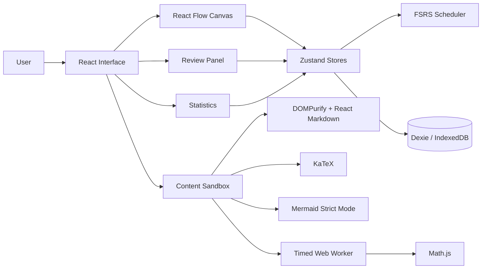

<div align="center">

# DataFlow

### Build knowledge spatially. Review it intelligently.

A local-first knowledge graph and spaced-repetition workspace for mastering technical concepts through connected learning.

<br />

[](https://github.com/brundag22/DataFlow/actions)
[](https://www.typescriptlang.org/)
[](https://react.dev/)
[](LICENSE)

</div>

---

## Overview

DataFlow turns technical learning into a visual, connected system.

Instead of storing isolated flashcards, DataFlow lets you model concepts as a **knowledge graph**, connect them through prerequisites, attach rich technical content, and review each concept using a spaced-repetition scheduler.

> **The goal:** understand how ideas connect, then remember them at the right time.

The application runs locally in the browser. Your knowledge graph, review cards, logs, and node positions are persisted in IndexedDB through Dexie.

## Why DataFlow?

Traditional flashcards are excellent for recall, but they often hide the structure behind the knowledge. DataFlow keeps both layers visible:

| Layer | What DataFlow provides |
| --- | --- |
| **Structure** | A visual graph of concepts and prerequisite relationships |
| **Understanding** | Descriptions, Markdown, LaTeX, Mermaid diagrams, and code examples |
| **Retention** | FSRS-inspired scheduling with four review ratings |
| **Progress** | Retention, review activity, streaks, card states, and mastery statistics |
| **Ownership** | Local-first storage with JSON export and import |

## Highlights

### Visual knowledge graph

Explore concepts on an interactive React Flow canvas. Nodes expose category, difficulty, review status, retention, and prerequisite relationships at a glance.

### Technical sandbox

Enrich nodes with content that is useful for real engineering and study workflows:

- Markdown explanations
- KaTeX formulas
- Mermaid diagrams
- JavaScript examples
- Math.js evaluation inside a Web Worker

### Spaced repetition

Review cards with the familiar four-choice flow:

| Shortcut | Rating | Meaning |
| ---: | --- | --- |
| `1` | Again | The concept was not recalled |
| `2` | Hard | The concept was recalled with difficulty |
| `3` | Good | The concept was recalled successfully |
| `4` | Easy | The concept was recalled effortlessly |

Press **Space** to reveal the answer during review.

### Prerequisite-aware learning

Prerequisite gating is optional and disabled by default. When enabled, a concept can enter the review queue only after every prerequisite reaches at least seven days of stability. Locked concepts are visibly marked on the graph.

### Local-first data ownership

DataFlow stores its working data in the browser and supports complete JSON export/import for portability:

- Knowledge nodes
- Review cards
- Review logs
- Graph positions

## Product Walkthrough

1. **Create your first node** from the empty canvas onboarding prompt or import a JSON backup.
2. **Open a node** to read its explanation and inspect its technical content.
3. **Create or edit nodes** with categories, tags, formulas, diagrams, code, and prerequisites.
4. **Review due concepts** using the keyboard-friendly rating flow.
5. **Inspect statistics** to understand retention and review activity.
6. **Export your data** whenever you want a portable backup.

## Architecture



## Scheduling Model

DataFlow uses an FSRS-inspired scheduler built in TypeScript.

The retrievability curve is:

```text
R(t, S) = (1 + (19 / 81) × t / S)^(-0.5)
```

Where:

- `R` is retrievability.
- `t` is elapsed time in days.
- `S` is card stability.
- The target retention is `0.90`.

The scheduler includes:

- Initial stability values for ratings 1–4.
- Difficulty clamped to the range `[1, 10]`.
- Explicit learning steps of **1 minute** and **10 minutes**.
- Review interval previews generated from the same scheduling function used to save cards.
- Relearning after lapses.
- Calendar-day streak calculation from distinct review-log dates.

## Technical Stack

| Area | Technology |
| --- | --- |
| Frontend | React 19.1, React DOM |
| Language | TypeScript 5.8 |
| Tooling | Vite 6 |
| Styling | Tailwind CSS 3, PostCSS, Autoprefixer |
| Graph | `@xyflow/react` |
| State | Zustand |
| Persistence | Dexie, `dexie-react-hooks`, IndexedDB |
| Formulas | KaTeX |
| Diagrams | Mermaid 11 with strict security mode |
| Markdown | `react-markdown` with DOMPurify sanitization |
| Layout | `@dagrejs/dagre` |
| Code execution | Web Worker with a three-second timeout |
| Testing | Vitest, fake-indexeddb |
| Quality | ESLint, Prettier, GitHub Actions |

## Getting Started

### Requirements

- Node.js 22 or later
- npm 10 or later
- A modern browser with IndexedDB and Web Worker support

### Installation

```bash
git clone https://github.com/brundag22/DataFlow.git
cd DataFlow
npm install
```

### Development

```bash
npm run dev
```

Open the local URL printed by Vite.

### Production build

```bash
npm run build
npm run preview
```

## Quality Commands

```bash
npm run lint
npm run typecheck
npm test
npm run build
```

The repository also runs these checks in GitHub Actions for pushes and pull requests.

## Project Structure

```text
DataFlow/
├── src/
│   ├── components/       UI, graph, review, layout, and sandbox components
│   ├── db/               Dexie database and JSON transfer helpers
│   ├── engine/           FSRS maths and review scheduler
│   ├── stores/           Zustand application state
│   └── types/            Shared TypeScript models
├── docs/
│   └── CHANGELOG.md
├── .github/workflows/
│   └── ci.yml
├── LICENSE
└── package.json
```

## Security Boundaries

DataFlow applies several defensive boundaries around rendered and executable content:

- KaTeX runs with `trust: false`.
- Mermaid uses strict security mode.
- Mermaid SVG output is sanitized with DOMPurify.
- Markdown is sanitized before rendering.
- User code runs in a Web Worker rather than on the page thread.
- The worker does not expose `document`, `window`, `indexedDB`, or canvas APIs.
- Long-running worker execution is terminated after three seconds.

The code runner is intended for educational examples, not for executing untrusted production workloads.

## Current Limitations

- Data is stored locally; there is currently no cloud synchronization.
- Browser storage can be cleared by the user or browser privacy settings.
- Code examples do not support canvas rendering.
- Mermaid-related bundles remain large and may produce Vite chunk-size warnings.
- Screenshots and hosted demo deployment are not included yet.

## Contributing

1. Create a feature branch.
2. Make one focused change at a time.
3. Run lint, typecheck, tests, and build locally.
4. Update documentation when behavior changes.
5. Open a pull request with a concise summary and validation results.

## License

DataFlow is available under the [MIT License](LICENSE).

<div align="center">

<br />

**DataFlow — connect the concepts, strengthen the memory.**

</div>
